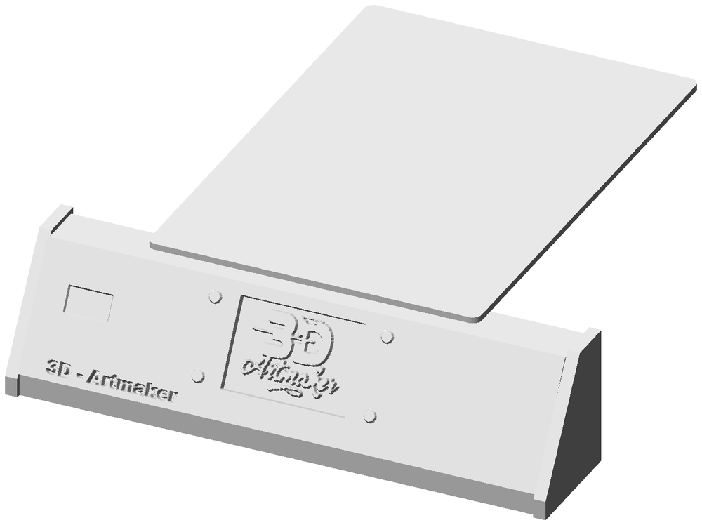
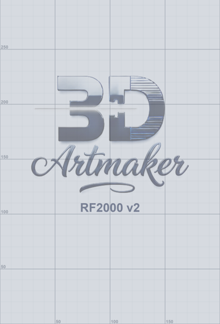

# Druckbett mit 3D-Artmaker-Logo für OrcaSlicer

Mit diesen Dateien zeigt OrcaSlicer statt der leeren Standardplatte dein Druckbett, und davor die Vorderfront des Druckers.

| Vorderfront (Bett-Modell) | Druckbett (Textur) |
|---|---|
|  |  |

- **Textur:** Raster alle 10 mm, alle 50 mm beschriftet, das 3D-Artmaker-Logo und der Druckername.
- **Modell:** die Bettplatte und davor die schräge Blende mit Display und Logo, OLED, Schrauben und dem Schriftzug „3D - Artmaker“. OrcaSlicer zeigt das Modell einfarbig grau, deshalb sind Logo und Schrift als Relief geformt und über Licht und Schatten zu sehen.

## 1. Dateien herunterladen

Lade für deinen Drucker **beide** Dateien herunter (der Link startet den Download):

| Drucker | Textur | Modell | Druckfläche |
|---|---|---|---|
| RF1000 | [RF1000_texture.png](https://github.com/Dennis02121978/3D-Artmaker/raw/main/orca/RF1000_texture.png) | [RF1000_bed.stl](https://github.com/Dennis02121978/3D-Artmaker/raw/main/orca/RF1000_bed.stl) | 240 x 245 mm |
| RF2000 | [RF2000_texture.png](https://github.com/Dennis02121978/3D-Artmaker/raw/main/orca/RF2000_texture.png) | [RF2000_bed.stl](https://github.com/Dennis02121978/3D-Artmaker/raw/main/orca/RF2000_bed.stl) | 200 x 245 mm |
| RF2000 v2 | [RF2000v2_texture.png](https://github.com/Dennis02121978/3D-Artmaker/raw/main/orca/RF2000v2_texture.png) | [RF2000v2_bed.stl](https://github.com/Dennis02121978/3D-Artmaker/raw/main/orca/RF2000v2_bed.stl) | 200 x 295 mm |

Lege beide Dateien in einen Ordner, in dem sie bleiben können, zum Beispiel `Dokumente/OrcaSlicer`. OrcaSlicer kopiert die Dateien nicht, sondern merkt sich nur, wo sie liegen. Verschiebst oder löschst du sie später, ist das Bett wieder leer.

## 2. In OrcaSlicer einstellen

1. Oben links deinen Drucker auswählen und daneben auf das **Bearbeiten-Symbol** (Stift) klicken.
2. Links auf **Basic information** gehen. Im Bereich **Printable space** stehen die beiden Felder:
   - **Bed custom texture:** auf **Load** klicken und `<Drucker>_texture.png` wählen.
   - **Bed custom model:** auf **Load** klicken und `<Drucker>_bed.stl` wählen.
3. Oben auf das **Speichern-Symbol** klicken und das Druckerprofil speichern.
4. OrcaSlicer **ganz beenden** und neu starten. Auf dem Mac geht das mit **Cmd+Q**, das rote Kreuz reicht nicht. Unter Windows das Fenster schließen.

Je nach Version heißen die Felder etwas anders, oder sie stehen im Fenster hinter dem Knopf neben **Printable area**.

## Wenn etwas nicht passt

| Was du siehst | Woran es liegt | Was hilft |
|---|---|---|
| Die Platte liegt versetzt neben dem Raster | Eine alte Fassung der STL (vor dem 20.11.2026), oder OrcaSlicer läuft noch mit der alten Datei | Die STL neu herunterladen, die alte Datei ersetzen und OrcaSlicer ganz beenden und neu starten |
| Logo und Raster wirken gestaucht | Die **Printable area** im Profil hat andere Maße als in der Tabelle oben, zum Beispiel beim RF1000 mit zwei Extrudern (200 statt 240 mm in X) | Nichts nötig, es betrifft nur die Anzeige. Das Raster stimmt dann nicht genau mit den Millimetern überein |
| Die Platte steht vorne und hinten weiter über als an den Seiten | Die Printable area ist kleiner als oben, zum Beispiel 200 x 223 mm im Marlin-Profil | Nur die Anzeige. Eine passende Variante lässt sich mit dem Skript unten erzeugen |
| Das Bett ist wieder leer | Die Dateien wurden verschoben oder gelöscht | Die Dateien zurücklegen oder in OrcaSlicer neu laden |

Fragen und Wünsche gerne im Forum: [OrcaSlicer: Druckbett mit 3D-Artmaker-Logo](https://3d-artmaker.de/viewtopic.php?t=91).

## Neu erzeugen

Die Dateien kommen aus einem Skript. Maße, Farben, Logo-Deckkraft und die Lage von Display und Schrift stehen oben in [`tools/make_orca_beds.py`](../tools/make_orca_beds.py):

```bash
python3 tools/make_orca_beds.py
```

Das Skript braucht `python3-pil` und `python3-numpy`. Das Logo kommt aus `skipr-bootlogo/logo.png`. Die STL ist um X/Y = 0 zentriert, weil OrcaSlicer den Nullpunkt des Modells in die Mitte der Druckfläche setzt.
